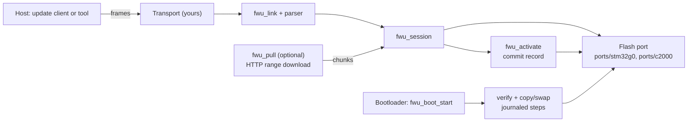

# fwu - a portable firmware update driver for microcontrollers

A bare-metal C99 driver that moves a new application image into a microcontroller and installs it safely: the running application writes the
image to a staging area, verifies it, records a commit in a power-loss-safe journal and resets; the bootloader then verifies the staged image
again and copies (or swaps) it over the application, resumable at every step. The core has no hardware dependencies; flash, crypto, transport and
bootloader hooks are interfaces that you or the supplied ports implement.

> **Status:** hardware use is limited to the targets and runs listed in [Support matrix](#3-support-matrix) and
> [`docs/TEST_RESULTS.md`](docs/TEST_RESULTS.md). The default profile (DEV) checks integrity with SHA-256 but **does not authenticate** the sender, and the
> signed profiles cannot work with the shipped crypto port. Read [Known limitations](#11-known-limitations) before using it in a product.

## 1. What it is for

* Updating the application of a resource-limited MCU (the code runs on a 16-bit-`char` TI C28x and on an ARM Cortex-M0+) over a link you already
  have: UART, BLE through a module (the example uses an FC41D), TCP, or CAN (host-tested only).
* Products that need a bootloader that **cannot be left half-updated**: every flash step of the installation is journaled and repeatable.
* Teams that want the update logic separated from the transport and from the MCU, and testable on a PC with a simulated flash.

Two ways to deliver the image are implemented:

* **Push:** a host tool sends the image in frames, stop-and-wait.
* **Pull (optional):** the host only says where the image is; the device downloads it over HTTP `Range` requests (Wi-Fi + TCP) and commits each
  range only after the whole HTTP response has arrived and its length was verified.

## 2. Capabilities

Only what is implemented in this repository; the evidence level of each is in `docs/TEST_RESULTS.md`.

| Capability | Where |
|---|---|
| Frame protocol with CRC-16, streaming parser with resynchronisation | `src/frame`, `src/session/fwu_proto.*` |
| Device-side update session state machine (HELLO, optional authorization, manifest, chunked download, verify, commit, abort, timeouts) | `src/session` |
| 138-byte manifest (product id, version, size, SHA-256, optional signature) and a verification pipeline | `src/manifest`, `src/verify` |
| SHA-256 (portable, 16-bit-`char` safe); Ed25519 only as a hook that currently **always fails closed** | `src/crypto` |
| Power-loss-safe activation: COPY mode, or SWAP with rollback and trial boots; progress recorded in an A/B journal | `src/activation`, `src/journal` |
| Anti-rollback version counters | `src/counters` |
| Platform-independent bootloader core (`fwu_boot_start` decides JUMP or STAY) | `src/boot` |
| Challenge-response authorization (host-tested; no example wires it) | `src/auth` |
| Link layer (ring buffer -> parser -> session -> transport), ISO-TP subset for CAN (host-tested only) | `src/transport` |
| Pull mode: HTTP/1.1 range client and controller | `src/pull` |
| Host-side update client (C) and a manifest/frame tool (Python) | `src/client`, `tools/fwu_package.py` |
| Flash ports and reference integrations | `ports/`, `examples/` |
| Host tests with a simulated flash, simulated crypto, loss-injecting link simulator and power-loss injection | `tests/`, `src/*/test_*.c` |

## 3. Support matrix

"Compiles" means compile-only with the vendor toolchain named; nothing is linked. "Hardware" distinguishes records stored here from maintainer reports.

| Target | Implemented in source | Host tests (stub) | Compiles | Tested on hardware | Notes |
|---|---|---|---|---|---|
| **TI TMS320F280049C** (LAUNCHXL-F280049C) | flash port `ports/c2000/f28004x`; example application + bootloader | core: yes; this port has no PC stub test (the alternative `f28004x_direct` has) | **yes**, TI `cl2000` 22.6.3 (ports and example) | pull-mode update: **recorded** log excerpt; BLE and UART updates and link-drop tests: **maintainer-reported**, no logs; power loss during copy: **not tested** | board numbers not checked against the TRM; example needs the FC41D module driver (not included) for BLE/pull |
| **ST STM32G0B1KEU6** | flash port `ports/stm32g0/flash`; bootloader example (no application example) | yes (128 checks against an ST HAL stub) | **yes**, GNU Arm 13.3.1 with the real ST HAL headers | an update over TCP completed on a device (**recorded**, session log); power-loss tests **maintainer-reported**, no details; ECC/NMI path unrecorded | flash-level power-loss and erase timing unverified |
| TI TMS320F2800157 | layout numbers only (`layout_f2800157.h`, draft, unverified) | - | - | - | **no flash port; not supported** |
| Other STM32 / other MCUs | - | - | - | - | **not supported**; see [`docs/PORTING_GUIDE.md`](docs/PORTING_GUIDE.md) |
| CAN / ISO-TP transport | `src/transport/fwu_isotp.*` | yes (against itself) | - | **not tested** | identifiers are placeholders; not checked against ISO 15765-2 |

Do not read the existence of a port as support: a new target needs the checks in the porting guide, and even the two listed targets are only as
verified as the table says.

## 4. Repository layout

```
src/                 portable core (one directory per module, host tests next to the sources)
  frame/ session/ transport/ client/ pull/ flash/ journal/ activation/ manifest/
  crypto/ verify/ counters/ boot/ auth/ config/ ring_buffer/ bytes/ crc/ error/
ports/
  stm32g0/flash/            STM32G0 flash port + ST HAL test stub
  c2000/f28004x/            TI Flash API wrapper + adapter (hardware-exercised path)
  c2000/f28004x_direct/     alternative C28x flash port, tested against a PC stub only
examples/
  c2000_launchxl_f280049c/  application + bootloader reference integration (README with memory map and build settings)
  stm32g0b1/                bootloader reference integration
tools/                      fwu_package.py (manifest/frame tool), selftest vectors generated by the C code
tests/                      run_tests.sh (host suite) and target_builds/ (compile checks for the vendor toolchains)
docs/                       architecture, integration, porting, API, testing, results, troubleshooting, evidence/
```

## 5. Architecture in one picture



Details, state machines and failure paths: [`docs/ARCHITECTURE.md`](docs/ARCHITECTURE.md).

## 6. Requirements

| Need | For |
|---|---|
| a C99 compiler for your MCU | the firmware |
| `bash` + `gcc` (GCC 10+ for `-fanalyzer`; only GCC 15.2.0/MSYS2 was used here) + `python3` | host tests and tools |
| TI Code Composer Studio / C2000 compiler, C2000Ware | the C2000 port and example |
| STM32CubeG0 HAL/CMSIS and STM32CubeIDE or GNU Arm | the STM32 port and example |
| FC41D module driver | only the C2000 example's BLE and pull transports (not included) |

Vendor material is not part of this repository; see [`THIRD_PARTY_NOTICES.md`](THIRD_PARTY_NOTICES.md) for where to get it.

## 7. Quick start

1. Run the host tests: `bash tests/run_tests.sh` (about three minutes).
2. Pick a port and read [`docs/INTEGRATION_GUIDE.md`](docs/INTEGRATION_GUIDE.md): add the listed sources, define exactly one profile and one board, set the layout.
3. Implement the transport `send` function and the bootloader hooks (`app_valid`, the jump), or start from the examples.
4. Build the manifest: `python tools/fwu_package.py build app.bin --product 1001 --version 2 --max-image-size 73728` (DEV profile: no signature).
5. Drive the update from a host that speaks the protocol (`src/client` is a C implementation).

## 8. API usage (excerpt from the C2000 application example)

This is copied from `examples/c2000_launchxl_f280049c/application/port/app_fwu.c`; it is not a complete program (flash adapter, transport and
buffers are defined elsewhere in that file).

```c
status = fwu_flash_adapter_init(&g_flash, APP_FWU_FLASH_BASE_WORD, APP_FWU_FLASH_LENGTH_OCTETS);
status = fwu_crypto_sw_init(&g_crypto_sw, &g_crypto);
/* g_boot_config: policy, layout, flash, crypto, product id, work buffers ... (see the file) */
status = fwu_boot_init(&g_boot, &g_boot_config);
status = fwu_parser_init(&g_parser, &g_rx.base);            /* g_rx: FWU_RINGBUF_DEFINE(app_rx, APP_FWU_RX_RING_SIZE) */

fwu_session_config_t config;
config.flash = &g_flash.flash;
config.activate = fwu_boot_activate(&g_boot);
config.verify = fwu_boot_verify_config(&g_boot);
config.auth = NULL;  config.require_auth = false;           /* DEV profile: no authorization */
config.running_image_version = (uint32_t)APP_FWU_RUNNING_VERSION;
config.chunk_size = APP_FWU_CHUNK_SIZE;
config.idle_timeout_ms = APP_FWU_IDLE_TIMEOUT_MS;
config.auth_max_failures = 3u;  config.auth_lockout_ms = 60000u;
config.work = g_session_work;   config.work_length = (uint32_t)APP_FWU_CHUNK_SIZE;
status = fwu_session_init(&g_session, &config);

g_transport.send = app_ble_send;  g_transport.poll = NULL;  g_transport.context = NULL;   /* your transport */
link_config.session = &g_session;  link_config.parser = &g_parser;  link_config.transport = &g_transport;
status = fwu_link_init(&g_link, &link_config);

/* main loop */
(void)fwu_link_poll(&g_link, now_ms);
if(fwu_link_reboot_ready(&g_link)) { /* drain the transmitter, then reset the MCU */ }
```

The bootloader side is `fwu_boot_start(&g_boot, &g_boot_config, &result)` returning `FWU_BOOT_JUMP_APP` or `FWU_BOOT_STAY`
(`examples/*/bootloader/`).

## 9. Build and test

```bash
bash tests/run_tests.sh                      # host test suite (34 test programs, 4 build variants each, static analysis, config rules)
python tools/fwu_package.py selftest         # host tool self-test
# compile checks with the vendor toolchains (need the vendor SDK files; see docs/TESTING.md)
bash tests/target_builds/arm_gcc_compile_check.sh
bash tests/target_builds/c2000_compile_check.sh
```

Last recorded results (2026-10-26): host suite **ALL MODULES PASSED** (3,586 checks at the `-O0` variant), 70 configuration combinations, ARM compile
13/13, C2000 compile 43/43. Reproduction details: [`docs/TESTING.md`](docs/TESTING.md).

## 10. Documentation

| Document | Content |
|---|---|
| [`docs/PROTOCOL.md`](docs/PROTOCOL.md) | wire protocol: frame format, messages, push and pull sequences, state machine, errors and timeouts |
| [`docs/ARCHITECTURE.md`](docs/ARCHITECTURE.md) | modules, data flow, state machines, failure propagation, memory and blocking behaviour |
| [`docs/INTEGRATION_GUIDE.md`](docs/INTEGRATION_GUIDE.md) | step-by-step integration with real code |
| [`docs/PORTING_GUIDE.md`](docs/PORTING_GUIDE.md) | the port boundary and contracts, what to test for a new target |
| [`docs/API_REFERENCE.md`](docs/API_REFERENCE.md), [`docs/api/`](docs/api/) | declarations, semantics, return codes, per module |
| [`docs/TESTING.md`](docs/TESTING.md), [`docs/TEST_RESULTS.md`](docs/TEST_RESULTS.md) | how to reproduce; what was run and what the evidence is |
| [`docs/TROUBLESHOOTING.md`](docs/TROUBLESHOOTING.md) | symptoms, causes (confirmed or hypothesis), diagnostics |
| [`docs/KNOWN_ISSUES.md`](docs/KNOWN_ISSUES.md), [`docs/REVIEW_FINDINGS.md`](docs/REVIEW_FINDINGS.md), [`docs/DESIGN_DECISIONS.md`](docs/DESIGN_DECISIONS.md) | open issues, review results, design rationale |
| [`examples/c2000_launchxl_f280049c/README.md`](examples/c2000_launchxl_f280049c/README.md), [`examples/stm32g0b1/README.md`](examples/stm32g0b1/README.md) | the reference integrations |
| [`CHANGELOG.md`](CHANGELOG.md), [`CONTRIBUTING.md`](CONTRIBUTING.md), [`SECURITY.md`](SECURITY.md), [`THIRD_PARTY_NOTICES.md`](THIRD_PARTY_NOTICES.md) | project files |

## 11. Known limitations

* **No authenticity in the DEV profile**; INDUSTRIAL/AUTOMOTIVE need Ed25519 verification, whose shipped hook always fails (`src/crypto/fwu_crypto_sw.c`).
* The DEV profile cannot be built with `-DFWU_PRODUCTION`; the TI board numbers are not checked against the reference manual.
* **Resume after power loss is not persistent**: an interrupted download restarts unless the device kept its RAM state.
* Verification of the whole image runs in one blocking call; its duration and the watchdog behaviour during flash erase and the bootloader copy are not measured.
* SWAP+ROLLBACK, authorization and CAN are host-tested only; nothing in the examples confirms a trial boot.
* Pull mode on the evidenced hardware reached about 1 KB/s with periodic 8 s stalls whose cause (below the pull layer) is not established.
* Source comments, API documents and all messages are in English; the **test programs' individual check descriptions are still partly in Turkish**.
* More: [`docs/KNOWN_ISSUES.md`](docs/KNOWN_ISSUES.md) and [`docs/REVIEW_FINDINGS.md`](docs/REVIEW_FINDINGS.md).

## 12. Contributing and security

See [`CONTRIBUTING.md`](CONTRIBUTING.md) and [`SECURITY.md`](SECURITY.md). Contact for the project: `furkan.yayla.dev@gmail.com`.

## 13. License

MIT License, see [`LICENSE`](LICENSE). Vendor SDKs, HALs and tool-generated headers referenced or partly included keep their own terms:
[`THIRD_PARTY_NOTICES.md`](THIRD_PARTY_NOTICES.md).
