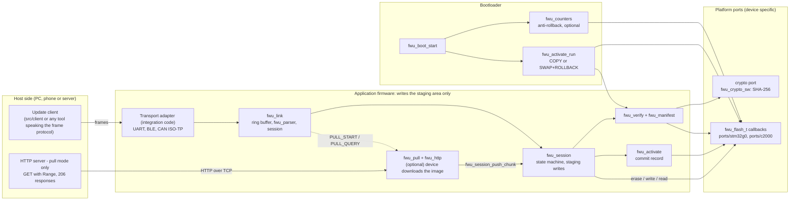
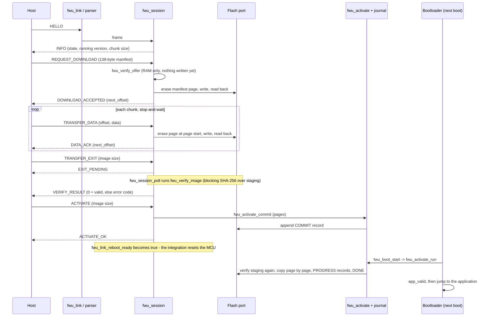
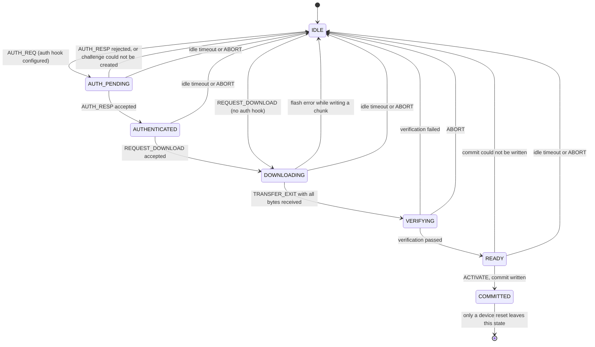
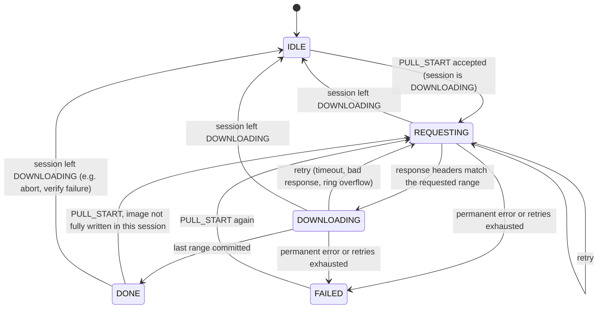
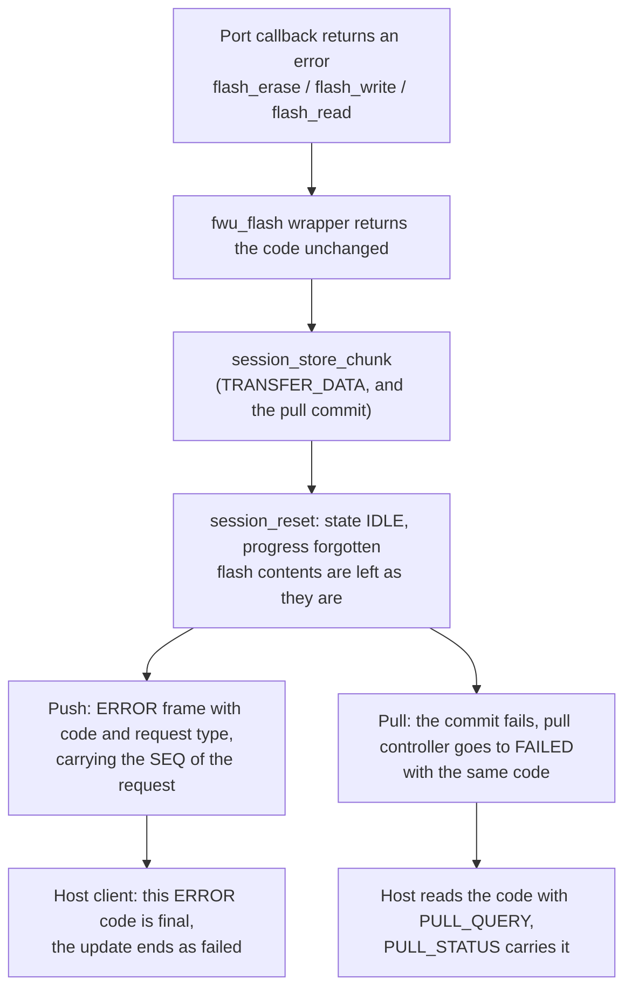
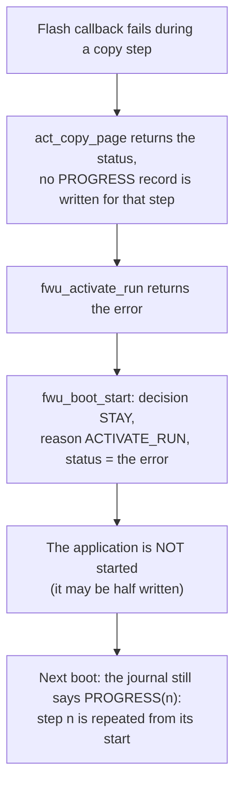
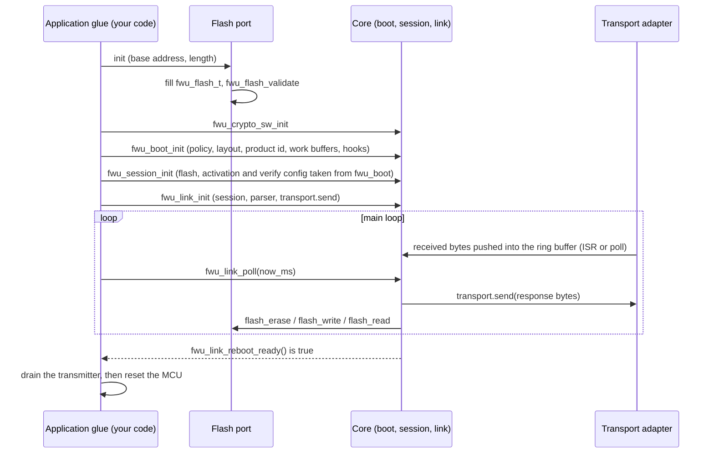

# Architecture

This document explains how the driver is built, for someone who will maintain, debug or port it. Every statement was checked against
the source in this repository; where behaviour could not be confirmed it is marked **UNVERIFIED**. Exact declarations, byte layouts and
return codes are in the per-module references under [`docs/api/`](api/) (index: [`API_REFERENCE.md`](API_REFERENCE.md)).
The wire protocol itself (frame format, messages, sequences) is specified in [`PROTOCOL.md`](PROTOCOL.md).

## 1. What the driver does

The driver moves a new application image from a **host** (PC, phone, server) into the flash of a microcontroller and lets a
**bootloader** install it, without ever overwriting the running application directly:

1. The running **application** receives the image and writes it to a separate **staging area** in flash, together with a 138-byte
   **manifest** (product id, version, size, SHA-256 digest, optional signature).
2. When the whole image has arrived, the application verifies it (manifest checks and SHA-256 over the staging copy).
3. On `ACTIVATE` the application writes one **commit record** into a power-loss-safe **journal** and resets the MCU.
4. The **bootloader** finds the commit record, verifies the staging copy again, copies it page by page over the application region
   (**COPY** mode) - or swaps it with rollback support (**SWAP+ROLLBACK** mode) - and records progress in the journal after every step,
   so an interruption at any point is resumed at the next boot. Then it jumps to the application.

Two ways to move the bytes are implemented:

* **Push:** the host sends `TRANSFER_DATA` frames (stop-and-wait, one chunk per frame).
* **Pull (optional):** the host only sends `PULL_START`; the device downloads the image itself with HTTP `GET` + `Range` requests
  and commits each range to staging after the whole range has arrived.

Design rules visible in the code (not just intentions): no dynamic memory (callers provide every buffer); core code never assumes an
8-bit `char` (it uses `fwu_byte_t`, a 16-bit container on C2000, `src/fwu_types.h`); no hardware access in `src/` (flash, crypto,
transport and hooks are interfaces); every fallible function returns a `fwu_return_e` code.

## 2. Modules and responsibilities

| Module (`src/...`) | Responsibility | Depends on | Platform-specific? |
|---|---|---|---|
| `fwu_types.h`, `error/`, `bytes/`, `crc/` | base types, status codes, byte-order helpers, CRC-16/MODBUS | - | no |
| `ring_buffer/` | single-producer/single-consumer byte ring (ISR writes, main loop reads) | - | no |
| `frame/` | frame encode/decode and the streaming parser (resynchronises on garbage, 500 ms frame timeout) | ring buffer, crc | no |
| `session/` | wire protocol (`fwu_proto`) and the device-side **update session state machine** (`fwu_session`) | flash, activation, verify, auth hook | no |
| `transport/` | `fwu_transport_t` contract, `fwu_link` (ring buffer -> parser -> session -> transport), ISO-TP subset for CAN, link simulator (tests) | frame, session | no (the transport itself is yours) |
| `client/` | **host-side** update client (state machine for HELLO ... ACTIVATE); not run on the device | transport/link, frame | no |
| `flash/` | flash interface (`fwu_flash_t` callbacks + validating wrappers) and a simulated flash for tests | - | **port** implements the callbacks |
| `journal/` | append-only self-validating records in flash (`fwu_journal`) and the A/B rotating variant (`fwu_journal_ab`) | flash | no |
| `activation/` | applies the staged image safely: COPY or SWAP+ROLLBACK, resumable from the journal; trial boots | journal, flash | no |
| `manifest/` | 138-byte manifest parsing and structure checks | - | no |
| `crypto/` | crypto port interface; real SHA-256 (`fwu_sha256`); software port (`fwu_crypto_sw`: SHA-256 real, Ed25519 hook **always fails closed**); simulated crypto for tests only | - | port can replace the software port |
| `verify/` | verification pipeline (product, version, size, key, signature, image digest) | manifest, crypto, flash | no |
| `counters/` | persistent minimum image/key version (anti-rollback), raised only after confirmation | journal, verify | no |
| `boot/` | platform-independent **bootloader core** `fwu_boot_start`: ties counters, verification and activation together and decides JUMP or STAY; contract fingerprint | counters, verify, activation | hooks (`app_valid`, `watchdog_arm`) are yours |
| `auth/` | challenge-response authorization (operator signature over a nonce) | crypto | RNG source is yours |
| `pull/` | HTTP/1.1 range client (`fwu_http`) and pull controller (`fwu_pull`) | session, ring buffer | TCP transport is yours |
| `config/` | protection profiles (DEV / INDUSTRIAL / AUTOMOTIVE), generic layout rules (`fwu_layout.h`), per-board number headers | - | board headers only hold numbers |

Platform and integration code lives **outside** `src/`:

* [`ports/stm32g0/flash`](../ports/stm32g0/flash) - flash port on the ST HAL, with a PC test stub.
* [`ports/c2000/f28004x`](../ports/c2000/f28004x) - TI Flash API wrapper (`flash_port`) and the adapter that fills `fwu_flash_t`
  (the path used by the hardware-exercised C2000 example); [`ports/c2000/f28004x_direct`](../ports/c2000/f28004x_direct) is an alternative
  port that has only been tested against a PC stub.
* [`examples/`](../examples) - reference integrations (C2000 application + bootloader, STM32G0 bootloader).

## 3. System view

The application and the bootloader are **two separate binaries** built from the same core with the same profile, board layout,
product id and chunk size. The bootloader publishes a 12-byte *contract record* (a 32-bit FNV-1a fingerprint of those settings,
`fwu_boot_info_encode`); an application can compare it with its own configuration with `fwu_boot_info_check`. In this repository
the STM32 example writes the record, and **no code calls `fwu_boot_info_check`** (documented in
[`api/activation-boot-counters.md`](api/activation-boot-counters.md), section 7).

## 4. Update lifecycle (push)

Message names and payload layouts: [`api/session-and-basics.md`](api/session-and-basics.md), section 5. The host client
(`src/client`) implements the host half, including retransmission with the same SEQ on timeout, resynchronisation to the device's
`next_offset`, and bounded restarts.

**Pull variant.** After `DOWNLOAD_ACCEPTED` the host sends `PULL_START` (server IPv4, port, target path). The device then sends
`GET <target>` with `Range: bytes=a-b` requests, accumulates each whole HTTP response in a RAM range buffer, checks that the body
length matches the requested range, and only then writes the range to staging chunk by chunk through `fwu_session_push_chunk` (the same
code path as `TRANSFER_DATA`). The host polls `PULL_QUERY` / `PULL_STATUS`; when the state is DONE it continues with `TRANSFER_EXIT`
and `ACTIVATE` as above. The control frames still need a transport (in the C2000 example: BLE); the HTTP bytes use a TCP socket.

## 5. State machines

### 5.1 Session (device side)

State names are `FWU_SESSION_*` (`src/session/fwu_session.h`). The full message-by-state table, timeouts and the authorization lockout are
in [`api/session-and-basics.md`](api/session-and-basics.md), section 7. In `COMMITTED` the session refuses `ABORT` and re-answers a repeated
`ACTIVATE`.

### 5.2 Pull controller

`FWU_PROTO_PULL_*` values and the exact rules (what counts as a retry, which errors are permanent, stale-response skipping) are in
[`api/pull-flash-ringbuffer.md`](api/pull-flash-ringbuffer.md), section 5. One quirk is documented there: after a committed range the
controller keeps its state (normally DOWNLOADING) while the next request is pending; the header description of REQUESTING does not mention this.

### 5.3 Activation (bootloader)

Phase is derived from the **last valid journal record**: `COMMIT` -> `PROGRESS(n)` ... -> `DONE` in COPY mode; in SWAP mode
`PROGRESS` records are followed by `TRIAL(k)` until the application calls the confirm function (`CONFIRMED`) or `k` reaches
`max_trial_boots` and a `REVERT` sequence restores the old image (`REVERTED`). `REJECTED` is written when verification rejects the staged
image. The recovery rule per interruption point is tabulated in
[`api/activation-boot-counters.md`](api/activation-boot-counters.md), sections 3 and 4. In this repository the only complete examples
use COPY mode; **no application code calls the SWAP confirm function** (`fwu_boot_app_finish_trial` / `fwu_activate_confirm`), so a SWAP
integration must add that call or it will roll back after `max_trial_boots`.

## 6. Flash layout

The generic rules live in `src/config/fwu_layout.h`; each board supplies only numbers (`src/config/layout_*.h`). Regions in address order:
bootloader, application, **staging** (first page = manifest, remaining pages = image), log/config, counters A/B, then the spare area
(journal A, journal B, and `K` scratch pages used only by SWAP mode). The layout header refuses inconsistent combinations at compile time
(for example staging smaller than the application region). The shipped boards:

| Board header | Status of its numbers |
|---|---|
| `layout_f280049c.h` (TI TMS320F280049C) | taken from TI's linker file; **not checked against the TRM**, so a `FWU_PRODUCTION` build needs `-DFWU_BOARD_NUMBERS_VERIFIED` |
| `layout_stm32g0b1.h` (ST STM32G0B1, 512 KB) | numbers for the part given in the requirements; see the header for what it states |
| `layout_f2800157.h` (TI F2800157) | draft split, **unverified**, no flash port for this device |

The concrete C2000 map used by the example (3 sectors bootloader, 10 application, 1 + 9 staging, ...) is tabulated in
[`examples/c2000_launchxl_f280049c/README.md`](../examples/c2000_launchxl_f280049c/README.md).

## 7. Error handling and recovery

**Principle (from the code):** no layer retries a flash operation; failures are passed up unchanged; the journal makes the bootloader
resumable; the bootloader never jumps to an application it could not install. The complete caller-by-caller table is
[`api/pull-flash-ringbuffer.md`](api/pull-flash-ringbuffer.md), section 1.5.4. Two representative paths:

### 7.1 A flash failure while the application writes the staging area

A flash error while writing the **manifest** in `REQUEST_DOWNLOAD` is handled differently: an ERROR frame is sent but the session state is
not reset (`fwu_session.c`, manifest write path). A read-back mismatch is reported with `FWU_ERR_FLASH_WRITE`; in the duplicate-chunk path
the session converts it to `FWU_ERR_BAD_BLOCK`, so a port must not use `FWU_ERR_FLASH_WRITE` for genuine read failures.

### 7.2 A flash failure while the bootloader installs the image

In the C2000 example the STAY decision makes the bootloader toggle LED5 forever; there is no recovery path or watchdog in that example.
Whether a product needs a recovery mode is an open decision (`docs/KNOWN_ISSUES.md`, issue 63).

### 7.3 Status codes seen by the host

* Protocol-level failures are `ERROR` frames `[code, request type]` with the request's SEQ; the C function that built the reply still
  returns `FWU_OK`.
* Verification results are a separate `VERIFY_RESULT` message (never an `ERROR` frame) carrying the code of `fwu_verify_image`.
* Frame-level problems (bad CRC, bad length) are absorbed by the parser and never reach the session.

## 8. Port and integration boundary

This is the order used by `examples/c2000_launchxl_f280049c/application/port/app_fwu.c`. What each interface requires from the integrator
(return values, alignment guarantees, blocking behaviour) is in [`PORTING_GUIDE.md`](PORTING_GUIDE.md); the step-by-step procedure is in
[`INTEGRATION_GUIDE.md`](INTEGRATION_GUIDE.md).

## 9. Execution context, blocking behaviour and memory

* **Single-threaded, polled core.** The core has no tasks or locks. Bytes arrive through a single-producer/single-consumer ring buffer
  (written by an ISR or poll loop, read by `fwu_link_poll`); everything else runs from the main loop. The ring buffer's guarantee is limited to
  single-core MCUs without weak memory ordering (known issue 1).
* **Blocking operations.** Flash callbacks are synchronous and return when finished. `fwu_session_poll` runs the image verification (SHA-256
  over the whole staging copy) in one call; its duration was not measured (known issues 40 and 49). `fwu_pull_poll` writes flash inside its
  call, so it blocks for the duration of the page erase and chunk writes.
* **C2000 specifics (from the port code).** Erase and write run from RAM (`.TI.ramfunc`) with global interrupts disabled; bytes arriving
  on a UART meanwhile can overflow its 16-element FIFO, which is why the push protocol is stop-and-wait.
* **Memory.** All state is in caller-provided objects and buffers: ring buffers, session work buffer (one chunk), verify/activate work buffers
  (256 elements in both examples), and in pull mode a range buffer of `range_bytes` elements. Measured sizes of the C2000 example (from
  the maintainer's link maps) and of the STM32 objects (compiled here) are in [`TEST_RESULTS.md`](TEST_RESULTS.md).
* **No dynamic allocation:** no `malloc`/`free` in `src/`; the C2000 maps show no `.sysmem` section linked.

## 10. Known limits that affect architecture decisions

* Signed profiles (INDUSTRIAL, AUTOMOTIVE) cannot work with the shipped software crypto port because its Ed25519 hook always fails closed.
* Resume after power loss is not persistent: an interrupted download restarts from the offset the device still holds in RAM only within the
  same power-up (known issue 51).
* Only COPY mode is exercised by the examples; SWAP+ROLLBACK is host-tested only.
* Pull mode throughput on the evidenced hardware was about 1 KB/s with retries (see [`TEST_RESULTS.md`](TEST_RESULTS.md)); the cause of the
  retries (lost bytes below the pull layer) was not established.

The consolidated list of defects and inconsistencies found while preparing this repository is [`REVIEW_FINDINGS.md`](REVIEW_FINDINGS.md).
