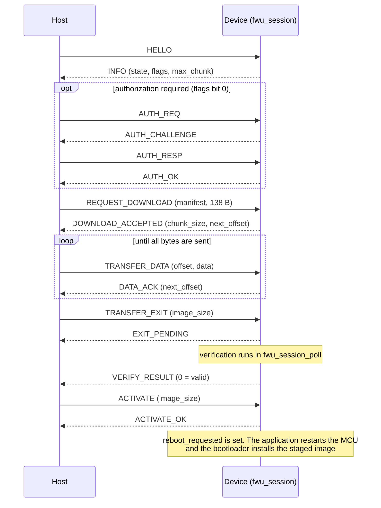
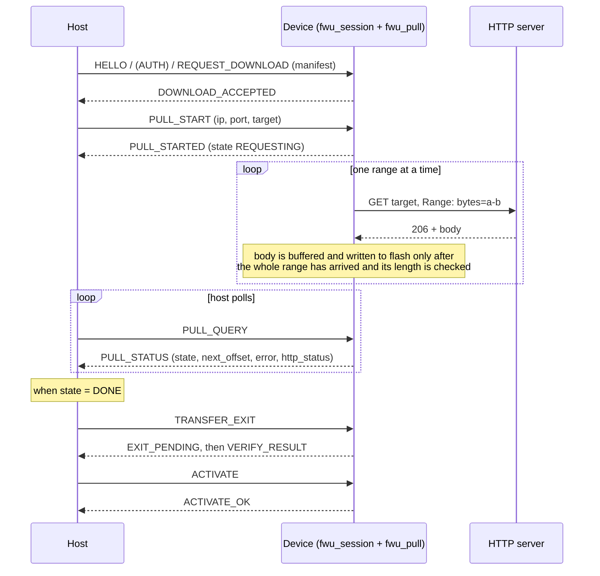
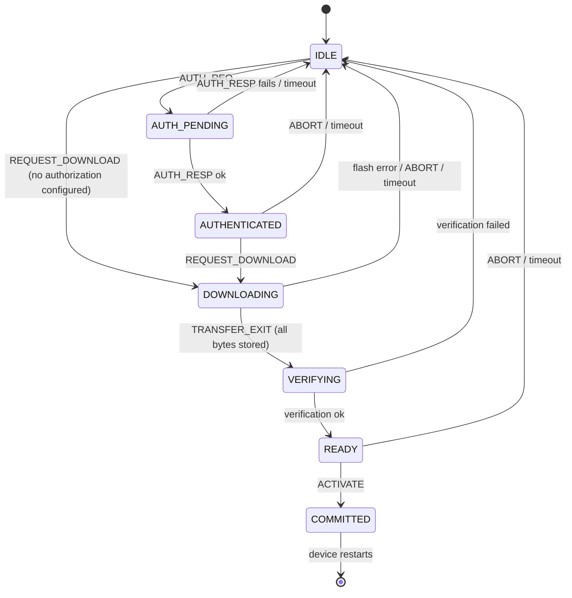

# Protocol specification

This document describes the wire protocol between a **host** (update tool, phone app, gateway) and a **device** running the driver:
the frame format, every message, the session state machine, the push and pull sequences, error handling and timeouts.

**Sources of truth** (the code wins if this document and the code ever differ):

| What | File |
|---|---|
| Frame layout, SOF/EOF, CRC placement | [`src/frame/fwu_frame.h`](../src/frame/fwu_frame.h) |
| Message types, payload layouts, constants | [`src/session/fwu_proto.h`](../src/session/fwu_proto.h) |
| State machine and per-message rules | [`src/session/fwu_session.c`](../src/session/fwu_session.c), [`fwu_session.h`](../src/session/fwu_session.h) |
| Pull-mode messages and HTTP behaviour | [`src/pull/fwu_pull.h`](../src/pull/fwu_pull.h) |
| Error numbers | [`src/error/fwu_error.h`](../src/error/fwu_error.h) |
| Manifest (138 bytes) | [`src/manifest/`](../src/manifest/) and [`api/config-journal-manifest.md`](api/config-journal-manifest.md) |

Detailed per-message behaviour with `file:line` references is in [`api/session-and-basics.md`](api/session-and-basics.md) (sections 5 and 7)
and [`api/crypto-verify-auth-frame.md`](api/crypto-verify-auth-frame.md) (section 8).

> **Status of the numbering.** The flow follows UDS (ISO 14229) concepts, but the message numbers are this project's own and have **not** been
> checked against the official UDS service numbers (`fwu_proto.h`, marked UNVERIFIED there). Do not assume UDS compatibility.

## 1. Conventions

* All multi-byte numbers are **big endian**.
* A *message* is the payload of a *frame*; the message type is the frame's TYPE byte.
* A response carries the **same SEQ** as its request. Response type = request type | `0x80` (a deliberate deviation from UDS's +0x40).
* A frame cannot have an empty payload, so messages without data carry a 1-byte placeholder (`0x00`).
* The protocol is **request/response, stop-and-wait**: the host sends one request and waits for the response before sending the next one.
  The one exception is the verification result (section 4.4), which arrives later as a separate message.
* The transport is not part of the protocol: the same frames are carried over UART, BLE (the example integration sends them as hex text through
  an FC41D module), TCP, or CAN (ISO-TP subset, `src/transport/`). The frame layer provides resynchronisation and integrity; the transport only moves bytes.

## 2. Frame format

```
 offset  size  field
 0       1     SOF      0xA5
 1       1     VER      0x01           frame format version
 2       1     TYPE     message type
 3       1     SEQ      0..255         wraps around
 4       2     LEN      payload length, big endian, 1..512
 6       LEN   PAYLOAD
 6+LEN   2     CRC-16   big endian
 8+LEN   1     EOF      0x5A
```

* Overhead is 9 bytes; the largest frame is 9 + 512 = 521 bytes (`FWU_FRAME_MAX_SIZE`).
* SOF (`0xA5`) and EOF (`0x5A`) are bit-inverses of each other, so the end of a shifted frame is not mistaken for a start.
* **CRC-16/MODBUS** (reflected polynomial `0xA001`, initial value `0xFFFF`) computed over `VER .. PAYLOAD` (SOF is not included). It is written
  high byte first. `fwu_crc16_classic_calculate` in [`src/crc/fwu_crc.h`](../src/crc/fwu_crc.h) is the reference.
* A frame with a bad CRC, wrong EOF or oversized length is dropped by the parser and never reaches the session. The parser then searches for the next SOF.

### 2.1 Example frames

Generated with [`tools/fwu_package.py`](../tools/README.md) (`frame_encode`), which is cross-checked against the C implementation
(`tools/selftest_vectors.py`). The HELLO frame is also one of the vectors in `tools/selftest_vectors.py` and appears in the recorded host logs.

| Message | SEQ | Bytes |
|---|---|---|
| HELLO (version 1) | 1 | `A5 01 01 01 00 01 01 A6 FD 5A` |
| PULL_START (192.0.2.10:8080, `/firmware.bin`) | 3 | `A5 01 15 03 00 14 C0 00 02 0A 1F 90 0D 2F 66 69 72 6D 77 61 72 65 2E 62 69 6E 30 96 5A` |
| PULL_QUERY | 4 | `A5 01 16 04 00 01 00 A9 48 5A` |
| PULL_STATUS (DOWNLOADING, next_offset 4096, error 0, HTTP 206) | 4 | `A5 01 96 04 00 08 02 00 00 10 00 00 00 CE 9D 79 5A` |
| TRANSFER_EXIT (image_size 1500) | 5 | `A5 01 12 05 00 04 00 00 05 DC BC 21 5A` |
| VERIFY_RESULT (0 = valid) | 5 | `A5 01 94 05 00 01 00 4B 31 5A` |
| ACTIVATE (image_size 1500) | 6 | `A5 01 13 06 00 04 00 00 05 DC 70 D3 5A` |
| ACTIVATE_OK | 6 | `A5 01 93 06 00 01 00 CF 84 5A` |

Reading the HELLO frame: `A5` SOF, `01` VER, `01` TYPE = HELLO, `01` SEQ, `00 01` LEN = 1, `01` payload (protocol version),
`A6 FD` CRC, `5A` EOF.

The PULL_START and PULL_STATUS rows were produced with the same encoder for illustration; they are example values, not captured traffic.
A captured pull session (host side) is in
[`evidence/c2000_f280049c_pull_update_host_log_excerpt.txt`](evidence/c2000_f280049c_pull_update_host_log_excerpt.txt).

## 3. Messages

### 3.1 Host to device and their responses

| Type | Request | Payload | Response | Response payload |
|---|---|---|---|---|
| `0x01` | HELLO | `version(1)` | `0x81` INFO | 13 bytes, see below |
| `0x02` | AUTH_REQ | `0x00` | `0x82` AUTH_CHALLENGE | `challenge(1..64)` |
| `0x03` | AUTH_RESP | `response(1..128)` | `0x83` AUTH_OK | `0x00` |
| `0x10` | REQUEST_DOWNLOAD | `manifest(138)` | `0x90` DOWNLOAD_ACCEPTED | 9 bytes, see below |
| `0x11` | TRANSFER_DATA | `offset(4)` `data(1..508)` | `0x91` DATA_ACK | `next_offset(4)` |
| `0x12` | TRANSFER_EXIT | `image_size(4)` | `0x92` EXIT_PENDING, later `0x94` VERIFY_RESULT | `0x01`; `code(1)` (0 = valid) |
| `0x13` | ACTIVATE | `image_size(4)` | `0x93` ACTIVATE_OK | `0x00` |
| `0x15` | PULL_START | `ip(4)` `port(2)` `length(1)` `target(1..96)` | `0x95` PULL_STARTED | 8 bytes (PULL_STATUS format) |
| `0x16` | PULL_QUERY | `0x00` | `0x96` PULL_STATUS | 8 bytes, see below |
| `0x1F` | ABORT | `reason(1)` | `0x9F` ABORT_OK | `0x00` |
| `0x3E` | KEEPALIVE | `0x00` | `0xBE` KEEPALIVE_OK | `state(1)` |
| any | (any failing request) | | `0x7F` ERROR | `code(1)` `request_type(1)` |

Notes:

* `TRANSFER_DATA` carries at most `FWU_PROTO_MAX_CHUNK` = 508 data bytes (frame payload 512 minus the 4-byte offset). The device announces the chunk
  size it actually wants in DOWNLOAD_ACCEPTED; the host must not send more.
* `ERROR.code` is the permanent error number from `fwu_error.h` (section 6), `request_type` is the type of the request that failed.
* In the host-tool direction the driver supplies encode/parse helpers for every layout in `fwu_proto.h` (`fwu_proto_encode_*`, `fwu_proto_parse_*`).

### 3.2 Payload layouts

**INFO** (13 bytes)

| Field | Size | Meaning |
|---|---|---|
| version | 1 | protocol version (`FWU_PROTO_VERSION` = 1) |
| flags | 1 | bit 0 = authorization required, bit 1 = signature required |
| product_id | 4 | the device's product id |
| running_image_version | 4 | version of the running application |
| max_chunk | 2 | largest TRANSFER_DATA data length the device accepts |
| state | 1 | session state number (section 5) |

**DOWNLOAD_ACCEPTED** (9 bytes)

| Field | Size | Meaning |
|---|---|---|
| chunk_size | 2 | data bytes per TRANSFER_DATA the device expects |
| mode | 1 | `0` = one acknowledgement per chunk (stop-and-wait); other modes are reserved |
| timeout_s | 2 | the device's idle timeout in seconds |
| next_offset | 4 | where the transfer continues (non-zero when resuming) |

**PULL_STATUS** (8 bytes; also the payload of PULL_STARTED)

| Field | Size | Meaning |
|---|---|---|
| state | 1 | `0` IDLE, `1` REQUESTING, `2` DOWNLOADING, `3` DONE, `4` FAILED |
| next_offset | 4 | image bytes pulled **and written to flash** (the resume point) |
| error | 1 | `fwu_error.h` number while FAILED, otherwise 0 |
| http_status | 2 | last HTTP status the server returned (0 if no response ever arrived) |

**PULL_START**: `ip(4)` is the server's IPv4 address (network order), `port(2)`, `length(1)` is the length of `target`, `target` is the HTTP request
target (path and query, starting with `/`, 1..96 bytes, no forbidden characters). The device builds the `Host` header itself from `ip:port`.
Port 0 is invalid.

## 4. Sequences

### 4.1 Push update (host sends the image)



Key rules:

* A `DATA_ACK` means the chunk was **written to flash and read back and compared**, not merely received.
* Chunks must arrive in order. Only the last chunk may be shorter than `chunk_size`. A repeat of the last chunk (lost ACK) is acknowledged again.
* `TRANSFER_EXIT` is accepted only when all `image_size` bytes were stored and `image_size` equals the size in the manifest.
* `REQUEST_DOWNLOAD` with the **same manifest** while already DOWNLOADING is a resume: the answer carries the current `next_offset`.
  A different manifest is refused (`BAD_STATE`).
* `VERIFY_RESULT` is a separate, later message (carrying the `TRANSFER_EXIT` SEQ); a host must keep reading after `EXIT_PENDING`.
  The verification covers the SHA-256 and, in a signed profile, the signature, product id and version policy.

### 4.2 Pull update (device fetches the image)

The manifest still comes from the host; only the image bytes come from a server. The device talks plain HTTP/1.1 (`GET` with a `Range` header) to
the server and expects `206 Partial Content`.



Key rules:

* PULL_START is valid only while the manifest is accepted (state DOWNLOADING). Repeating it with the same target is harmless (idempotent).
  After FAILED or DONE a new PULL_START resumes from the offset where the session stopped.
* The server's reported total size is compared with the manifest size before any byte is written (`FWU_ERR_PULL_SIZE_MISMATCH`).
* Each range is retried from the last offset **written to flash** (`next_offset`); a partly received range is discarded.
* The server is not trusted: a wrong or corrupt file is rejected by the SHA-256/signature verification.
* `PULL_START`/`PULL_QUERY` are handled by `fwu_pull`, not by `fwu_session`. The integration routes frames with
  `fwu_pull_handles(type)` to `fwu_pull_on_frame`, everything else to `fwu_session_on_frame`. A build **without** `fwu_pull` answers these two types
  with `ERROR(UNKNOWN_MESSAGE)`.
* The HTTP leg and the module hooks (sending and receiving TCP bytes) are the integration's job; see
  [`api/pull-flash-ringbuffer.md`](api/pull-flash-ringbuffer.md) and the C2000 example. On the reference hardware the pull
  throughput was low (about 1 KB/s, with stalls); that observation is open, see [`TROUBLESHOOTING.md`](TROUBLESHOOTING.md) and [`KNOWN_ISSUES.md`](KNOWN_ISSUES.md).

### 4.3 Resume after an interruption

Push: send `HELLO`, then `REQUEST_DOWNLOAD` with the identical manifest; the device answers with `next_offset` and the host continues from there.
Pull: the same, then `PULL_START` again. If the device lost its session (idle timeout, reset, flash error) the transfer restarts from the beginning.

### 4.4 Verification result and activation

After `TRANSFER_EXIT` the device answers `EXIT_PENDING` immediately and verifies in `fwu_session_poll` (it may take longer than the idle timeout, so
the timeout is not applied in VERIFYING). The result arrives as `VERIFY_RESULT` with code `0` (valid) or the permanent error number.
`ACTIVATE` writes the commit record. The device then asks the application to restart (`reboot_requested`); the **bootloader** performs the
installation on the next boot (COPY, or SWAP with rollback). The result is handed to the application through the bootloader contract record; that
part is not carried by this protocol.

## 5. Session state machine



| State | Number (INFO, KEEPALIVE_OK) |
|---|---|
| IDLE | 0 |
| AUTH_PENDING | 1 |
| AUTHENTICATED | 2 |
| DOWNLOADING | 3 |
| VERIFYING | 4 |
| READY | 5 |
| COMMITTED | 6 |

HELLO and KEEPALIVE are answered in every state. ABORT is refused in COMMITTED. The full table of which message is accepted in which state is in
[`api/session-and-basics.md`](api/session-and-basics.md) section 7.2.

## 6. Errors, timeouts and lockout

* **Request-level failure** is an `ERROR` frame (`0x7F`) `[code][request_type]` with the request's SEQ. The code is the number from `fwu_error.h`
  (always 1..255 on the wire). The host distinguishes, for example, `BAD_SIGNATURE` (50) from `CRYPTO_FAILURE` (51) by this number.
* **Verification failure** is reported in `VERIFY_RESULT`, never as `ERROR`.
* **Transport-level failure** (bad CRC, bad EOF, truncated frame) never reaches the session: the frame is dropped and the host sees a missing response.
  The host should retry the **same request with the same SEQ**; repeated requests are designed to be idempotent where the table in section 4 says so.
* **Idle timeout** (`idle_timeout_ms`, announced as `timeout_s` in DOWNLOAD_ACCEPTED): a session in AUTH_PENDING, AUTHENTICATED, DOWNLOADING or READY
  that receives no frame for this time returns to IDLE. It is not applied in IDLE, VERIFYING and COMMITTED. During a pull, `fwu_pull` refreshes
  the session activity so the timeout does not fire while the device is downloading on its own.
* **Authorization lockout**: after `auth_max_failures` consecutive wrong AUTH_RESP the device answers AUTH_REQ with `LOCKED_OUT` (62) until
  `auth_lockout_ms` has elapsed.
* **Authorization (when enabled)**: the device creates a challenge (`1..64` bytes), the host answers with `1..128` bytes computed by the product's
  authorization hooks. The algorithm is supplied by the integration; see [`api/crypto-verify-auth-frame.md`](api/crypto-verify-auth-frame.md).

Frequently seen codes (full list: `src/error/fwu_error.h`, [`api/session-and-basics.md`](api/session-and-basics.md)):

| Code | Name | Typical cause |
|---|---|---|
| 12 | `BAD_STATE` | message not allowed in the current state |
| 31 | `BAD_LENGTH` | payload length differs from what the message requires |
| 33 | `BAD_MANIFEST` | manifest failed validation |
| 34 | `IMAGE_TOO_LARGE` | image larger than the staging area |
| 35 | `HASH_MISMATCH` | SHA-256 of the staged image differs from the manifest |
| 40 / 47 | `FLASH_WRITE` / `FLASH_ERASE` | flash operation failed |
| 50 / 51 | `BAD_SIGNATURE` / `CRYPTO_FAILURE` | signature invalid / crypto backend failure |
| 52 / 53 | `PRODUCT_MISMATCH` / `VERSION_REJECTED` | image is for another product / anti-rollback policy |
| 60 | `UNKNOWN_MESSAGE` | type not handled |
| 61 | `BAD_BLOCK` | offset or size does not match the expected value |
| 62 | `LOCKED_OUT` | authorization lockout active |
| 80 / 81 / 82 / 83 | `PULL_PROTOCOL` / `PULL_HTTP_STATUS` / `PULL_TIMEOUT` / `PULL_SIZE_MISMATCH` | pull-mode failures |

## 7. Implementing a host

The reference host tool (a PC application) is **not** part of this repository. To implement one:

1. Build frames with the layout in section 2; [`tools/fwu_package.py`](../tools/fwu_package.py) contains a small, tested encoder/decoder and the
   manifest builder that can be used as a starting point or as a cross-check.
2. Obtain the 138-byte manifest from the update package (`fwu_package.py build`).
3. Follow section 4.1 (push) or 4.2 (pull). Always keep reading after `EXIT_PENDING` until `VERIFY_RESULT` arrives.
4. Resend an unanswered request with the same SEQ after a timeout; use the device's `timeout_s` as an upper bound for a pause in the transfer.

## 8. What this document does not cover

* The manifest field layout and the package format: [`api/config-journal-manifest.md`](api/config-journal-manifest.md), [`tools/README.md`](../tools/README.md).
* Bootloader behaviour (staging, COPY/SWAP, rollback, counters): [`ARCHITECTURE.md`](ARCHITECTURE.md).
* The BLE hex-text encapsulation used by the example integration and the FC41D module commands: [`examples/c2000_launchxl_f280049c/README.md`](../examples/c2000_launchxl_f280049c/README.md).
* Authenticated encryption of the transport: not provided. Integrity is a CRC-16 (not a security mechanism); image authenticity relies on the
  manifest hash/signature check, and Ed25519 signatures are not implemented (signed profiles fail closed), see [`KNOWN_ISSUES.md`](KNOWN_ISSUES.md).
